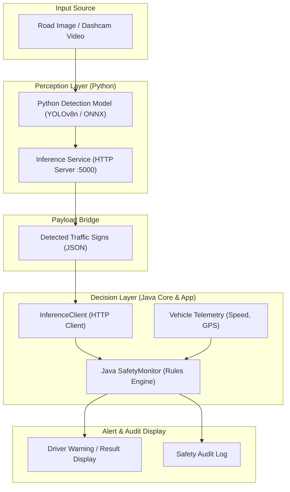

# System Architecture & Module Responsibilities

The system decouples high-throughput deep learning visual perception (Python) from deterministic road safety evaluation logic (Java).

---

## 1. End-to-End Data Flow

```text
             Road Image / Video
                      |
                      v
             Python Detection Model
                      |
                      v
             Detected Traffic Signs
                      |
                      v
              Java SafetyMonitor
                      |
                      v
             Warning / Result Display
```

### Mermaid Architecture Diagram



---

## 2. Module Responsibilities

### `train/` (Model Training & Export)
- **`requirements.txt`**: Pinned machine learning libraries (`torch`, `torchvision`, `ultralytics`, `opencv-python`, `numpy`, `pandas`, `scikit-learn`, `matplotlib`, `PyYAML`).
- **`train.py`**: Trains YOLO object detectors or custom CNN classifiers on traffic sign data.
- **`evaluate.py`**: Computes mAP, recall, precision, and confusion matrices on validation/test splits.
- **`export_model.py`**: Converts trained PyTorch checkpoints (`.pt`) into optimized ONNX (`.onnx`) and TorchScript formats.

### `python/` (Inference & Microservice)
- **`service.py`**: Lightweight HTTP microservice (`http://127.0.0.1:5000/detect`) that accepts raw image buffers or filepaths, executes YOLO inference, and returns structured JSON arrays.
- **`inference.py`**: Standalone command-line inference script for images or video feeds.
- **`utils.py`**: Normalization, label dictionary mappings, bounding box rendering, and Java JSON formatting.

### `java-core/` (Core Domain Logic & Unit Tests)
- **`pom.xml`**: Standalone Maven library project configuring Java 17 and JUnit 5.11.4 with Surefire 3.5.2.
- **`Detection.java`**: Immutable domain model capturing class ID, label, confidence, coordinates `(x, y, width, height)`, and timestamp.
- **`SafetyMonitor.java`**: Rule engine determining `shouldWarn()` and generating prioritized alerts (`INFO`, `WARNING`, `CRITICAL`) based on vehicle telemetry.
- **`SafetyMonitorTest.java`**: Comprehensive JUnit 5 test suite with 100% test pass rate.

### `java-app/` (Application Orchestrator)
- **`pom.xml`**: Executable Maven application depending on `com.traffic:java-core:1.0.0`.
- **`InferenceClient.java`**: High-performance HTTP client connecting Java to the Python inference microservice.
- **`Main.java`**: Application entry point orchestrating image acquisition, inference querying, safety monitor evaluation, and warning output.

---

## 3. Integration Options

| Integration Option | How It Works | Recommendation |
| :--- | :--- | :--- |
| **Option 1: Python Inference Service** *(Implemented)* | Java sends image bytes over HTTP to Python (`http://127.0.0.1:5000/detect`) and receives detections as JSON. | **Easiest initial integration**: Keeps Python ML dependencies decoupled from the Java runtime; allows independent scaling and debugging. |
| **Option 2: Embedded ONNX Runtime (Java)** | Java loads the exported `best.onnx` directly using the `com.microsoft.onnxruntime` dependency. | Advanced: Eliminates network overhead for ultra-low latency on embedded microcontrollers. |
