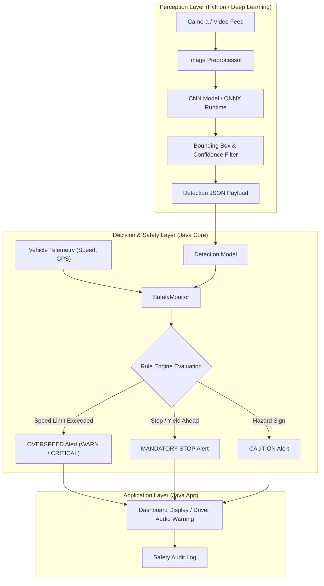

# System Architecture

The Traffic Sign Recognition and Road Safety system is designed as a hybrid, multi-tier architecture separating high-throughput deep learning perception from deterministic, low-latency safety decision logic.

## Component Breakdown

### 1. Perception Layer (`train/` and `python/`)
- **`train/train.py`**: Trains deep convolutional neural network backbones using PyTorch on labeled traffic sign datasets (e.g. GTSRB).
- **`train/export_model.py`**: Converts PyTorch weights into ONNX (`.onnx`) or TorchScript representations for deployment across multiple runtime targets.
- **`python/inference.py`**: Performs inference over live camera streams or pre-recorded dashcam footage, identifying sign classes and bounding coordinates.

### 2. Core Safety Engine (`java-core/`)
- **`Detection.java`**: Immutable domain model capturing class ID, natural language label, confidence score, bounding box coordinates, and detection timestamp.
- **`SafetyMonitor.java`**: State-aware safety evaluation engine that correlates detected signage with current vehicle speed and road conditions, firing prioritized alerts (`INFO`, `WARNING`, `CRITICAL`).

### 3. Application Execution (`java-app/`)
- **`Main.java`**: Driver application entry point orchestrating safety monitoring lifecycle and telemetry stream ingestion.
